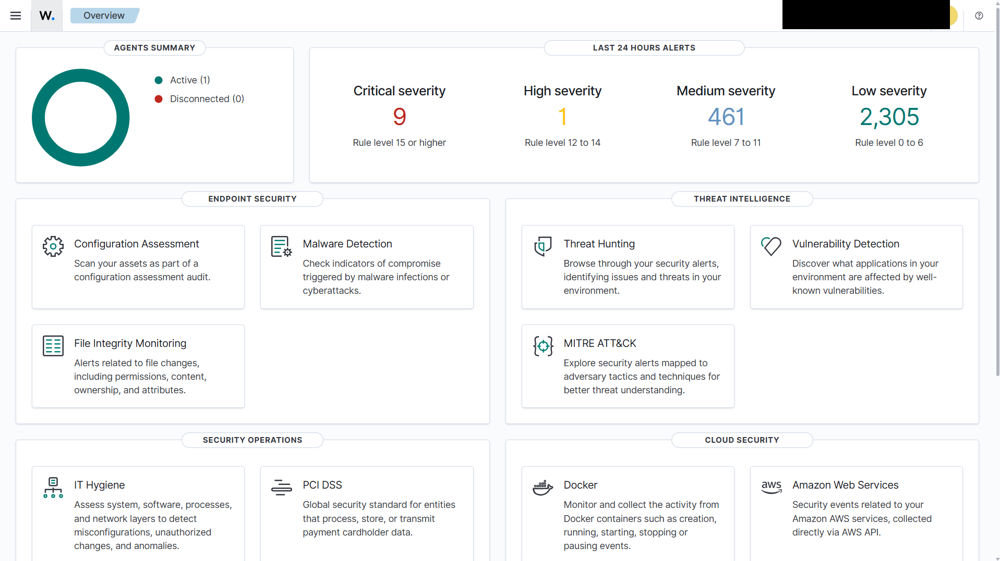
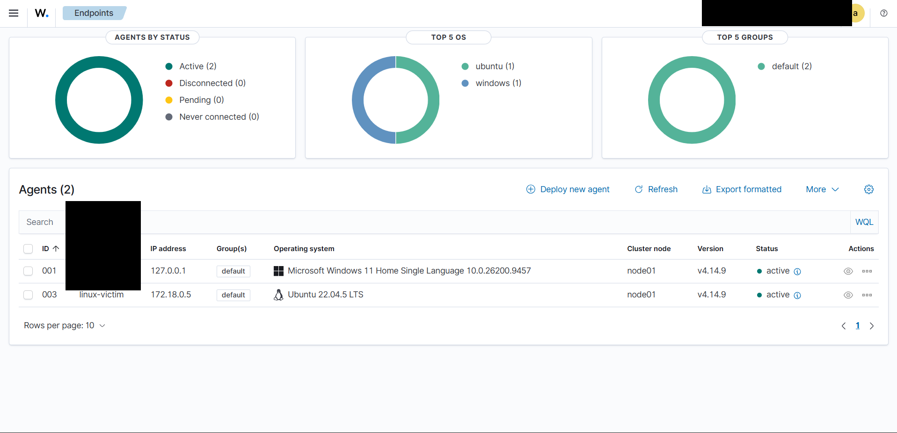
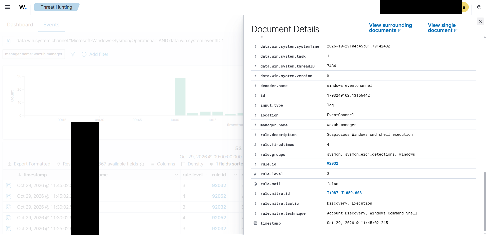
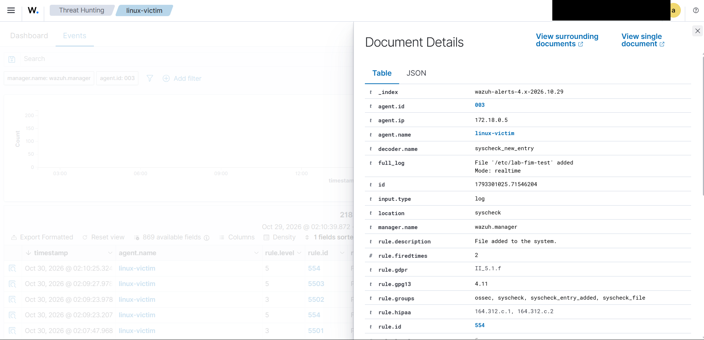
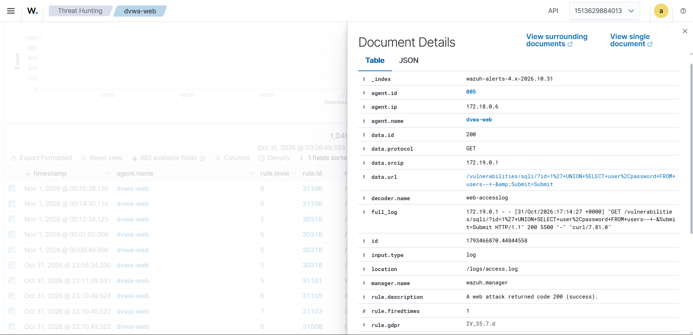
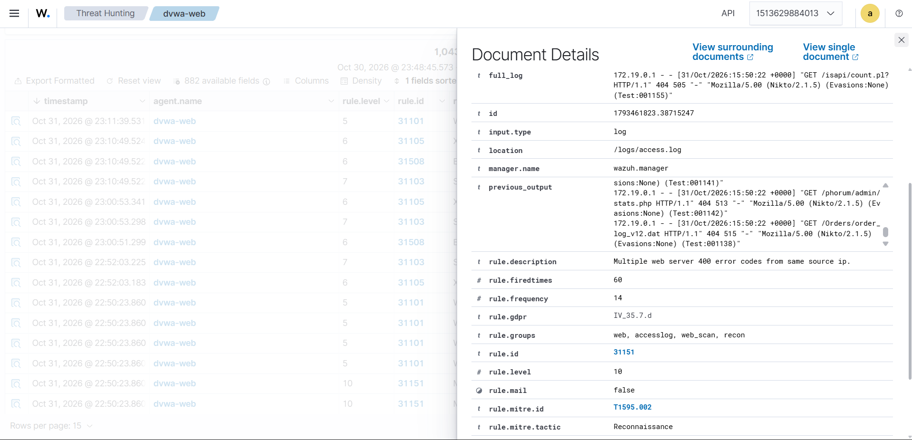

# Home Lab SIEM & SOC — Wazuh

A self-hosted defensive security lab running on a personal laptop: Wazuh SIEM in WSL2/Docker, a Windows endpoint with Sysmon + Wazuh agent, a Linux victim container with SSH/rsyslog/FIM, and DVWA with Apache log forwarding.

## Status

- Wazuh 4.14.9 single-node stack is running.
- Active agents: Windows `001`, Linux victim `004`, DVWA web `005`.
- Completed: Phases 0–3, 4A, 4B, 4C, 5A, 5B, and 5C.
- Project finalized; Phase 6 (ESP32 wireless/physical/IoT) is optional and deferred.
- NVIDIA `NvContainerLocalSystem` crash loop was resolved by updating the driver to 582.78.
- Tuning is intentionally narrow (92213/92058); no global suppression.

## Architecture

```text
Windows 11 host
└─ Sysmon + Wazuh agent 001
   └─ Security / System / Sysmon / PowerShell / FIM
        │ TCP 1514
WSL2 Ubuntu (Docker) ─────────────────────────────────────
├─ wazuh.manager / wazuh.indexer / wazuh.dashboard
├─ Linux victim (agent 004)
│  └─ sshd, rsyslog, /var/log/auth.log, FIM /etc,/home,/root
└─ DVWA + sidecar agent 005
   └─ Apache access/error logs via shared volume
```

## Detection Coverage

| Source | Examples | Wazuh rules |
|---|---|---|
| Windows Security | Failed logon 4625 | 60122 |
| Windows Sysmon | Process creation, file create | 92031/92032/92058/92213 |
| Windows PowerShell | Script block 4104 | 91815/91816 |
| Windows FIM | Tasks, startup, registry | 550/553/554 |
| Linux SSH | Failed password / PAM | 5503, 2502 |
| Linux sudo | Failed sudo attempt | 5401 |
| Linux FIM | File added/changed | 554/550 |
| Web (DVWA) | Web scan, SQLi attempt/success, XSS | 31101, 31151, 31103, 31106, 31105 |

## Screenshots

> Screenshots are redacted to remove hostnames and usernames.

### Dashboard overview


### Agents active


### Sysmon process telemetry


### Linux file integrity monitoring


### Successful SQL injection (DVWA)


> `31103` indicates an SQL injection attempt; `31106` indicates the web attack returned HTTP 200. Wazuh does not parse the response body.

### Web scan detection


## Documentation

- [docs/README.md](docs/README.md) — documentation index.
- [docs/01-PROJECT-REPORT.md](docs/01-PROJECT-REPORT.md) — full project report.
- [docs/02-ACTIVITY-TRACKING.md](docs/02-ACTIVITY-TRACKING.md) — activity tracking.
- [docs/03-LESSONS-LEARNED.md](docs/03-LESSONS-LEARNED.md) — technical and SOC lessons.
- [docs/06-LAB-JOURNAL.md](docs/06-LAB-JOURNAL.md) — chronological lab journal.
- [docs/08-TUNING.md](docs/08-TUNING.md) — tuning rules and risk notes.

## Privacy

- Hostnames and usernames are sanitized (`LAB-WIN`, `analyst`).
- Published screenshots are redacted.
- Raw screenshots are kept outside this repository.
- Lab credentials are placeholders or local `.env` values; `.env` is ignored.
- Do not commit `.env`, `client.keys`, private keys, or raw screenshots.

## Repository Layout

```text
home-lab/
├─ docs/                 # reports, tracking, journal, redacted screenshots
├─ phase4/               # DVWA, Linux victim, web log agent
├─ phase0-windows.ps1    # disk/WSL tuning
├─ phase1-docker.sh      # Docker Engine
├─ phase2-wazuh.sh       # Wazuh single-node
├─ phase3-*.{ps1,sh,conf}# Sysmon + Wazuh agent
└─ wazuh-tuning-rules.xml
```

## Notes

- All testing is performed on hardware owned by the author.
- The lab is intentionally local-only; dashboard/API are not exposed to the internet.
- WSL runs with 6 GB RAM / 4 vCPU as a trade-off for a 16 GB host.
